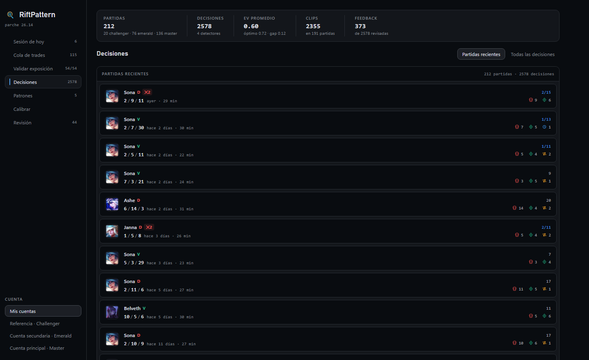
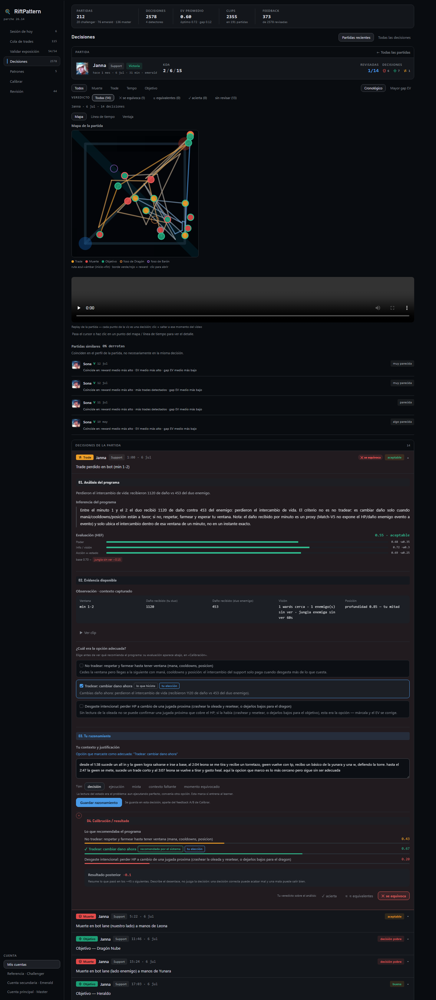
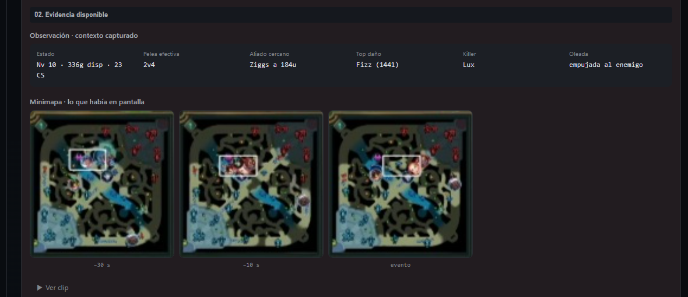
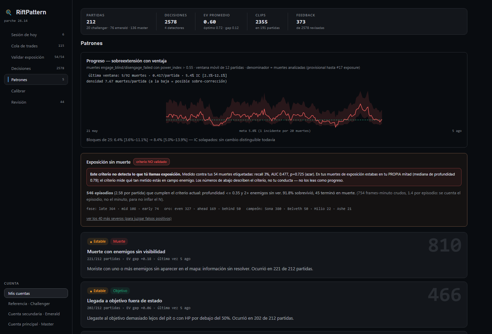
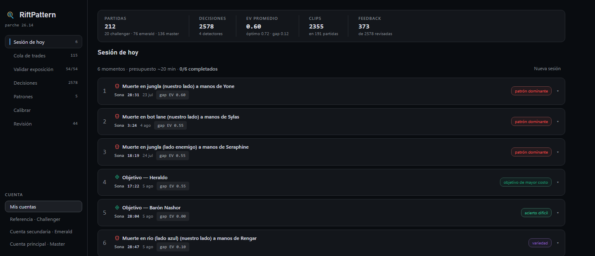

# RiftPattern

**A League of Legends coaching engine built for one player: behavioral analysis
of my own ranked games on the climb to Challenger.**

Most stats sites tell you *what* happened (KDA, gold, win rate). RiftPattern tries
to tell you *what you should have decided, and why*. It ingests my ranked games,
detects the individual **decision points** inside each one, evaluates the choice
I actually made against the alternatives, and produces a written argument. That
argument is not a flag or a number: it is context, options with expected value,
and prose. My feedback on those arguments trains a preference model that
recalibrates how the engine weighs each factor.

The bet behind it: climbing out of high elo is a *behavioral* problem
(consistency), not a mechanical one. The engine's job is to surface the mistake
you keep repeating while knowing it's wrong. For my account, the measured
dominant pattern is **over-extending while ahead**.

> Built as a real tool I use on my own account, not a demo. The dashboard and the
> generated coaching prose are in Spanish (I'm the target user). The code and
> docs are in English.

**By the numbers** (database figures measured 2026-09-25, own games only, the
reference cohort excluded; test count measured 2026-09-27):

| Own ranked games | Decision points | Human marks | Active detectors | Tests |
|---:|---:|---:|---:|---:|
| 310 | 4,407 | 505 | 4 | 678 |

The dashboard's review list shows 3,741 of those decision points: trades the
engine scores as won are still detected and stored, but hidden from review.

---

## Screenshots

> The dashboard UI is in Spanish (I'm the target user). The captions below
> explain each view.

**Recent matches.** The dashboard opens on recent games rather than on a raw
list of decisions. Each row shows the champion portrait, K/D/A, age, duration,
review progress and how the match's decision points split across the four
detectors. A flat list of all decisions stays available as a secondary view,
with its filters.



**Each decision becomes an argument, not a flag.** An expanded decision is a
four-stage review: *01 Program's analysis*, *02 Available evidence*, *03 Your
reasoning*, *04 Calibration / result*. The option picker, at the end of stage
02, is neutral: it shows no EV, no bar and no "recommended" badge. The EV
breakdown and the later outcome only appear in stage 04 once an option has been
saved, not merely selected. Stage 01 keeps the program's reading of the
situation but not its verdict: the sentence comparing what I did with the
highest-EV option, the HEF verdict and the EV breakdown all stay behind that
gate. (The screenshot below predates this gate and the new `death` options: its
stage 01 still shows the EV comparison and an option labelled "lo que hiciste".)



**What was on screen.** Inside the evidence stage, a strip of minimap crops is
taken from the recording of the game itself, at a few seconds before the
decision. The labels depend on the detector: −30 s, −10 s and the event for a
death or a trade; −90 s, −45 s and −15 s before an objective. The crops show fog
of war, wards and icons that Riot's API does not expose. Each crop can be
enlarged. It shows what was *available* on screen, not what I was looking at.



**Honest progress measurement.** The dominant pattern is tracked over a moving
window with a Wilson confidence interval. When the intervals overlap, the verdict
is "no distinguishable change yet" rather than a cherry-picked win. Below it, a
criterion that failed its blind validation stays on screen, labelled "criterio
NO validado" with the numbers that sank it, instead of being quietly removed.



**A curated review session.** An anti-bias mix of unmarked moments: the dominant
pattern by worst EV gap, an expensive objective, a hard correct call, and
variety. The point is to review without doomscrolling.



---

## How it works

```
Live Client capture (1 Hz) + game recordings + Riot Match-V5
        ->  ingestion  ->  SQLite  ->  4 decision detectors
        ->  evaluation (HEF)  ->  options with EV + written argument
        ->  review dashboard  ->  human feedback
        ->  Bradley-Terry preference learner  ->  HEF weights
```

The whole evaluation path is deterministic: the same match data always yields
the same decisions, EVs and prose.

1. **Capture.** A 1 Hz poller reads the in-game Live Client API for exact
   per-second state (HP, mana, gold, position). Riot's Match-V5 timeline
   backfills the rest, at one frame per minute. Game recordings (video plus an
   input-event log) are linked to matches for clips and the minimap strip. Only
   ranked games are ingested. Normals and remakes are tombstoned so they are
   never fetched again.
2. **Detect decisions.** Four detectors turn a match into discrete decision
   points:
   - `death` covers every death, classified by the real action (over-extension,
     failed disengage, calculated sacrifice, …).
   - `trade` covers bilateral bot-lane damage exchanges during laning.
   - `tempo` covers fights the team took without me.
   - `objective_readiness` asks whether the team was actually set up for that
     dragon or baron.
3. **Evaluate.** A hierarchical evaluation function (HEF) scores each state on
   `power`, `info`, `action_fit` and `wave`. Each option gets an expected value.
4. **Argue.** Each decision becomes an argument: what I did, what was optimal,
   and why. The alternative is always spelled out, never just "you played it
   wrong". The prose comes from **deterministic per-detector templates** that
   read the same structured row the EVs come from. There is no generative model
   in the loop, so the same row always yields the same text, the text can be
   tested like any other output, and it cannot claim something the row doesn't
   contain.
5. **Learn.** I mark decisions (agree / equivalent / disagree, which option was
   actually right, and why I'm marking). A Bradley-Terry preference model learns
   HEF weights from those marks. It is cross-validated and sits behind a
   guardrail, so the engine's judgment can track mine over time. So far the
   learned weights have not beaten the defaults out of sample, and the defaults
   stay active.
6. **Measure progress.** A progress view tracks the dominant pattern over a
   moving window with Wilson confidence intervals. That lets me answer "am I
   actually improving?" without fooling myself with outcome bias.

See [ARCHITECTURE.md](ARCHITECTURE.md) for the full design.

---

## Design decisions worth calling out

These are the parts I'm most proud of:

- **Stdlib-only, on purpose.** Python standard library + `requests`, React over
  UMD as a single `dashboard.html` with no build step, and SQLite in WAL mode. No
  FastAPI, Vite or ORM. The constraint keeps the whole system small and
  inspectable. I only add a framework when a concrete pain justifies it.
- **Feedback survives re-analysis.** Re-running the detectors deletes and
  reinserts every decision. Human feedback is preserved by a stable key, and
  marks are validated by a semantic *fingerprint* of the option set rather than a
  brittle index or timestamp. Refactoring a detector therefore doesn't silently
  throw away months of labeling.
  - When a detector stops firing where it used to, the orphaned marks are
    *archived* rather than dropped. Those notes are the field evidence I diagnose
    the detectors with.
  - A mark that no longer matches the current options still shows on the card,
    labeled as historical, and it is listed in the Review queue so it can be
    redone.
- **Options are stated from the prior context, never from the result.** A
  decision should offer one real axis (trade or don't, go for this objective or
  take a higher-value play), written from what was knowable at that instant.
  Phrasing an option from the outcome is outcome bias dressed as coaching, and it
  corrupts the preference model. The rule is applied to `trade`, `death`
  (fight or flee, try to save the fight or don't add your death, take the objective
  or leave alive) and `objective_readiness` (contest or concede the pit, whether
  your presence is decisive, this objective or a higher-value play). EVs come
  from the local setup before the play, not from how it ended. `tempo` is still
  pending (see [Known limitations](#known-limitations)).
- **One detector can be re-analyzed in place.** The general re-analysis deletes
  and reinserts every detector. Changing one detector's vocabulary uses a
  separate tool that re-runs only that detector, requires its decision keys to
  match the stored ones one to one, and updates only the columns the detector
  produces. Ids, marks, clips and timestamps stay untouched; a dry run reports
  which marks become historical before anything is written, and the write is
  preceded by a full backup.
- **The UI must not dictate the answer.** A read-only check
  (`scripts/anchoring-check.py`) measures how often the option I mark as right
  coincides with the system's max-EV option.
  - With the old picker, which showed EV and the recommendation while I chose,
    the match rate was 85% (273/323 when first measured; the script reproduces
    84.4%, 190/225, over the marks that are still valid). The HEF's own measured
    accuracy is about 52%, so the learner was being trained on a copy of itself.
  - After neutralizing the picker, the first batch (all trades, whose prose
    names no option) matched 3/9 = 33% (Wilson 95% CI 12.1–64.6%). That is below
    the 60% suspicion threshold, but with n = 9 the interval still reaches
    64.6%. It is an indication, not a confirmation.
  - The picker was not the only channel. Stage 01 prose, the HEF verdict on the
    collapsed row and the Calibrate view also named the answer; they now stay
    hidden until an option is saved. A test pins every cut marker in the
    dashboard to the literal template text in the detector, so rewording a
    sentence cannot silently reopen the leak.
- **I/O separated from pure logic** in every detector. `_gather_facts` does all
  the database work and `_evaluate` is pure, which makes the criterion branches
  unit-testable without a database.
- **Honest measurement, built to refute.**
  - Progress is reported with confidence intervals.
  - A pre-registered experiment is sealed in git before it runs.
  - A detector was validated against an anchor set that was generated blind.
  - A headline number the project had been quoting ("70% of objectives had no
    vision set up beforehand") was checked against video and
    [withdrawn as a measurement artifact](docs/experiments/vision-proxy-validation.md).
    The real rate is 42.9%.
- **Historical rewrites run only on a registered copy.** Correcting the state
  that past trade decisions were evaluated on is done by a tool that edits a
  closed, digest-checked set of rows, two columns only, and only on a registered
  copy of the database. It has been rehearsed with an exact rollback. It has
  **not** been applied to the production database.
- **678 characterization tests** pin the behavior as a safety net for
  criterion refactors.

---

## Known limitations

- **`tempo` still needs a discriminating situational signal.** Its options and
  EVs still depend partly on how the fight ended. Removing those outcome terms
  was tried: "Rotate" became the top option in 63 of 63 decisions, because the
  situational signals the detector reads today barely vary between cases. The
  vocabulary stays as it was until a real signal exists (value of what I was
  doing, setup at the fight, numbers). Marks on `tempo` are not independent of
  the engine.
- **Which options appear together still partly predicts the answer.** After the
  `death` and `objective` rewrites, the option set predicts the highest-EV
  option in about 58% and 68% of decisions (down from 99.8% and 96%). For
  `death` that is roughly the base rate of fleeing being right; for `objective`
  it comes from what I did being correlated with the setup, plus one fixed rule
  for objectives that must be defended.
- **Only the last choice is stored.** Once a saved option reveals the
  calibration, a different option can still be chosen and saved; the backend
  keeps the latest one, not the first independent choice.
- **Editing a note can revive a legacy mark.** For old marks made before
  fingerprints existed, validity falls back to the mark's timestamp. Editing only
  the note refreshes that timestamp and can make a stale mark count again.
- **Possible hindsight in other branches.** Outside `tempo`, a few branches may
  still condition options or EVs on what happened afterwards; how often this
  happens in the stored data has not been measured.
- **The trade PRE regeneration is not applied to production.** New analyses use
  the corrected temporal contract, and the rewrite of historical rows has been
  rehearsed on a copy (840 rows, exact rollback). Past trade decisions are still
  evaluated on the old, up-to-a-minute-stale state until that step is
  authorized, and there is deliberately no command that applies it to the
  production database.
- **Timeline positions are per minute.** Match-V5 gives one position frame per
  minute and no ward positions at all, so any positional inference from the
  timeline is approximate.
- **One player's sample.** Some questions cannot be settled with a single
  player's data. The exposure study was archived after failing its blind
  validation (AUC 0.477). The comparison against the reference player
  ([policy delta](docs/experiments/policy_delta.md), in Spanish) closed as null
  for lack of power.

- **Loss patterns** ([experiment report](docs/experiments/2026-10-27-patrones-de-derrota.md),
  in Spanish; [read-only script](scripts/loss_patterns.py)). Across 291 games,
  the associations that held up were team gold at minute 14, own deaths before
  minute 14, and chained early deaths: win rate was 91.7% above +2000 gold vs
  9.5% below −4000, and about 69–70% with two or fewer early deaths vs about
  46–48% with four or more. Video-labeled “causes” (early enemy roams and late
  objective deaths) did not replicate with a second independent rater (55–65%
  inter-rater agreement) or Riot event data. A clock check, with each label
  carrying the game clock read from its frame, ensured every label came from an
  image actually reviewed. These are correlations, not causal findings.

---

## Setup

Requires Python 3.12+ and a free Riot API key.

```bash
# 1. install
python -m venv .venv
.venv\Scripts\python.exe -m pip install -r requirements.txt
.venv\Scripts\python.exe -m pip install -r requirements-dev.txt   # for tests

# 2. configure
copy config.example.toml config.toml
#   then edit config.toml: add your Riot API key (https://developer.riotgames.com)
#   and your account(s). config.toml is gitignored so your key stays local.

# 3. fetch static game data (champion/item data, patch-versioned)
.venv\Scripts\python.exe scripts\download_game_data.py

# 4. run the pipeline, then open the dashboard
.venv\Scripts\python.exe scripts\sync_ascent.py --all
.venv\Scripts\python.exe scripts\dashboard.py        # http://localhost:8766

# tests
.venv\Scripts\python.exe -m pytest
```

`config.toml` in the repository root is the default. To use a config file
somewhere else (a second setup, or a synthetic one for a demo), set
`LOL_COACH_CONFIG` to its path; an explicit path passed in code still wins over
both.

The suite needs no network and no Riot data. 690 tests in total. On a fresh clone 667 pass and 23 are skipped: 18 compare the extracted trade scanner against a commit that only exists in the private working history, 4 need permission to create symlinks (Windows), and 1 needs a populated database. Without a `config.toml`, the test setup points the dashboard at a throwaway synthetic config (`LOL_COACH_CONFIG`) outside the repo, so the dashboard tests still run.

The minimap strip needs a one-time calibration per recording source. You drag a
rectangle over the minimap on a sample frame, and the result is stored in
`data/minimap_crop.json`. An uncalibrated source shows a "not calibrated" notice
instead of a guessed crop.

---

## Disclaimer

RiftPattern isn't endorsed by Riot Games and doesn't reflect the views or opinions
of Riot Games or anyone officially involved in producing or managing Riot Games
properties. Riot Games and all associated properties are trademarks or registered
trademarks of Riot Games, Inc.

## License

[MIT](LICENSE)
