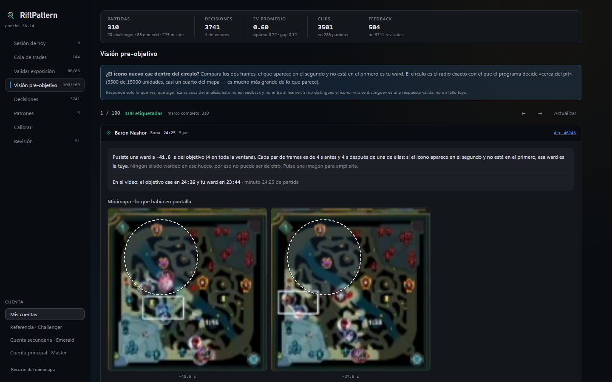

# Validating the pre-objective vision proxy against video

**Status:** closed (2026-08-14). **Outcome:** the proxy is broken; the headline
figure it produced was a measurement artifact and has been withdrawn.

## The question

`objective_readiness_v1` reports, for every epic objective (dragon, herald,
baron), how many wards the player placed "near the pit" in the 90 seconds before
it was taken. Aggregated over the player's own games, the count was zero for
**772 of 1,098 objectives (70.3%)**. Read at face value that is a strong
behavioral claim: the player almost never sets up vision before an objective.

The number could mean two different things:

- **(a)** a real habit of reactive vision, or
- **(b)** a proxy that systematically under-counts.

This study decides between them by checking the proxy against the recorded video.

## Why the proxy was suspect

Riot's Match-V5 timeline does not give ward positions. A `WARD_PLACED` event
carries the creator, a timestamp and the ward type, and nothing else (measured:
0 of 3,000 sampled `WARD_PLACED` events carry a position, against 3,000 of 3,000
`CHAMPION_KILL` events). The detector therefore approximates the ward's position
with **the placer's position in the timeline frame at or before the placement**.
Timeline frames are one per minute, so that position can be up to 60 seconds
old: a ward placed at the pit is attributed to wherever the player was up to a
minute earlier.

## Break threshold

Let *p* be the share of the proxy's zeros that are false (the player did place a
ward within the radius). The proxy was declared broken if **p ≥ 0.30**. The
threshold was fixed before labelling began. Unlike the attention experiment, it
was not sealed in a separate commit ahead of the result.

## Method

**Sampling frame** (own ranked games only, read-only queries):

| Step | n | Note |
|---|---:|---|
| Own objectives | 1,098 | |
| Proxy says 0 own wards near the pit | 772 | 70.3%, the published figure |
| ... and the player placed **no** ward in the window | 297 | a correct zero by construction; cannot refute the proxy |
| ... and the player placed **at least one** ward, counted as far | 475 | the only place the proxy can be wrong |
| ... with a video clip and at least 90 s of margin | 445 | |
| ... with the ward in a verifiable interval and **no allied ward placed in the same gap** | 195 | unambiguous attribution |

Two exclusions matter. A case where the player placed no ward is correct by
construction and would only dilute *p*. A case where an ally also warded in the
same inter-frame gap cannot be attributed: a new icon on the minimap could be
either ward. Wards placed after −15 s are also excluded, because no later frame
would show them.

**Frozen sample.** 100 cases, ordered by a hash of each decision's stable key,
stored in their own table (`vision_sample`). The sample is frozen on purpose: the
sampling frame grew as new games were ingested (from 195 to 216 while ingestion
caught up), and recomputing it moved the denominator in the middle of labelling.
A case that drops out is reported as dropped, not silently removed.

**Labelling.** One case per screen in a dedicated dashboard view, keyboard-driven
(1 = inside the circle, 2 = outside, 3 = unreadable). For each ward, the
[minimap strip](../../ARCHITECTURE.md#minimap-strip-evidence-from-the-video)
shows crops from the recording taken ±4 s around the exact second of placement,
zoomable to about 6×, with the detector's 3,500-unit radius drawn to scale on the
crop. Labels live in `vision_proxy_labels`. They are not feedback and never
reach the learner.

## Results

| Measure | Value |
|---|---|
| Labelled | 100 (2 unreadable, 98 readable) |
| False zeros | **62 of 98 = 63.3%, 95% CI [53.4, 72.1]** |
| Break threshold | p ≥ 0.30. The whole interval lies above it |
| Corrected rate of objectives with no own ward near the pit | **42.9%, 95% CI [39.1, 47.2]**, not 70.3% |
| Objectives miscounted | about **301 of 1,098** |

The corrected rate propagates *p* back through the funnel:
`0.703 × [0.385 + 0.615 × (1 − p)]`, where 0.385 is the share of zeros where no
ward was placed (correct by construction) and 0.615 the share where the proxy can
fail.

Of the two readings, **(b)** holds: the 70% described the proxy, not the player.

## Causes

1. **Temporal resolution.** The ward's position is taken from a per-minute frame,
   up to 60 s stale. This alone explains the false zeros the study found.
2. **Radius, an independent defect.** `VISION_NEAR_PIT_UNITS = 3500` on a map
   about 15,000 units wide is 23% of the map's width. "Near the pit" covers
   almost a quarter of the map. Fixing the position lag would not fix this.

## Declared limits

- **What the labels measure.** Labels were read from the **camera rectangle** on
  the minimap at the second of placement, not from the ward icon. They measure
  where the player was looking when placing the ward, not where the ward landed.
  That is still a much finer time resolution than the audited proxy (the exact
  second against a frame up to 60 s old), so "the proxy fails often" holds. The
  exact number of misplaced wards does not.
- **Single player, single sample.** 98 readable cases from one player's games.
  The interval is reported for exactly that reason.

## A negative finding: computer vision on these crops is closed

The minimap crop measures **121 px in 95% of clips** (852×480 recordings) and
182 px in the remaining 5% (1280×720). None is 1080p. At that size a ward icon is
about 4 to 5 px. That is not enough material to infer or train on, which closes
the option of detecting wards by computer vision on these recordings. The low
unreadable rate (2%) is consistent with this: labelling used the camera
rectangle, which is large, not the icon.

## What it changed

- The 70% figure was withdrawn from every place that cited it. Where the rate is
  quoted, it is 42.9% [39.1, 47.2], with the method's limit attached.
- The general lesson became a working rule: **a rate derived from a proxy is not
  a base rate until the proxy has been validated against a higher-resolution
  source.**
- The detector's proxy itself has **not** been replaced yet. Both defects (the
  frame lag and the radius) are documented as open. No fix can come from the
  timeline alone, and the video route for ward icons is closed at the resolution
  above.

Related read-only study: [policy delta](policy_delta.md) (in Spanish), which
compares action choice in objective setup against a Challenger reference player
and closed as null for lack of power.
